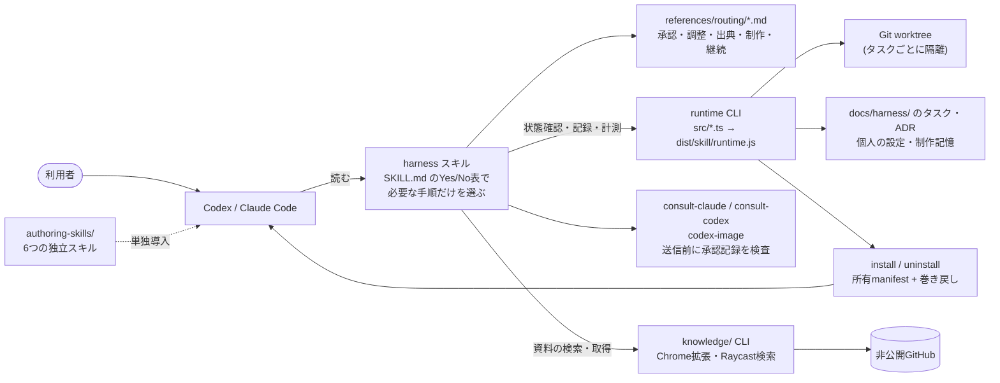

# Codex Harness

AIコーディングエージェント（Codex、Claude Code）に **「仕様を示す → 明示的に承認を得る → 隔離した作業場所で実装する → 別の担当が独立にレビューする → 統合する」** という開発手順を踏ませるための、スキル（Markdownの手順書）とローカルCLIです。エージェントは速く実装できる反面、仕様の確認や検証が抜けやすいため、その手順を再利用できる形にし、状態確認・記録・Git worktree・計測・安全な導入を小さなNode.js製CLIで支えます。

[English summary](#english-summary) / [開発記録の案内](docs/maintainers/development-records.md) / [文書索引](docs/README.md)

<a id="できること"></a>

## 主な機能

- **仕様と承認** — 実装前に範囲・受入条件を示し、UIには視覚モックを添えます。承認は提示した仕様版・範囲に紐づけて別に記録します。
- **実装と独立レビュー** — 担当には必要な情報だけを渡し、タスクごとにGit worktreeで作業を隔離します。実装者とは別の担当が実際の差分を読んでレビューします。
- **Claude/Codexへの相談** — 開かれたアイデア、重要な判断、提案の批評で別系統のモデルに独立した意見を求め、親が統合します。外部への送信は事前承認の記録がある範囲に限ります。
- **改善ループ** — UI・文書へのフィードバックを、根拠つきで記録します。1回きりの修正は「候補」、ユーザーが続けたいと明言したものは対象の範囲を決めた「制作指針」として、次回の制作で参照します。
- **ナレッジベースと検索** — Chromeで保存した本文・メモ・画像を非公開GitHubと同期し、まず少数の候補を探し、その要約（タイトル・出典・説明をまとめた短い「カード」）で選んでから、必要な本文・画像だけを読みます。
- **再利用できる6つのスキル** — ルール・担当・調整手順の作成、構成の確認、仕様計画、スライド制作を単独でも使えます。

```text
仕様・モック → 明示承認 → 実装(worktree) → 独立レビュー → 統合・検証
     ↑                  保存した判断・資料・制作指針を次回に参照
```

エージェントが手順書を読んで従う方式で、常駐の自動実行サービスではありません。CLIが承認やモデル起動を強制するものでもありません。コードで守るのは、機械的に判定できる部分（インストールの所有確認、送信承認記録の判定、worktree作成の前提確認、計測の比較可否）だけです。送信の前に承認の判定を呼ぶこと自体は手順書の指示で、Claude Codeではworker起動時のモデル指定の検査をCLIではなくプラグインのhookが行います。

## 構成



| 構成要素 | 役割 | 場所 |
| --- | --- | --- |
| スキル本体 | 入口の判定表と、承認・調整・出典・制作・継続の各手順。CodexとClaude Codeで共通の本文を使い、ホスト差は別文書に分けます | `plugins/codex-harness/skills/harness/` |
| ランタイムCLI | 設定の解決、タスク記録、worktree作成、計測、所有管理付きの導入・解除。実行時の追加npm依存はありません | `src/*.ts` → `dist/skill/runtime.js` |
| Claude Codeプラグイン | worker用エージェント定義、起動を検査するhook、挙動評価（eval）。同じスキル本文から配布物を組み立てます | `plugins/claude-harness/` |
| 独立スキル | ルール・担当・ワークフロー作成、構成確認、仕様HTML、スライド計画。本体なしで導入できます | `authoring-skills/` |
| ナレッジ基盤 | 耐久保存、GitHub同期、文字検索、段階取得のCLI。Chrome拡張とRaycast検索は個別に導入します | `knowledge/`、`integrations/raycast-knowledge/` |
| ビルドと配布 | `scripts/build.cjs` がTypeScriptをコンパイルして自己完結した配布物（Codex用・Claude Code用）を生成し、`npm pack`（`prepack` でビルドを実行）がnpm tarballを作ります | `scripts/build.cjs`、`package.json` |

## 設計上の見どころ

実装とテストで確認できる点を挙げます。手順（Markdown）に頼る部分と、コードで守る部分を分けています。

- **承認の前に実装しない（手順＋評価）** — 入口のSKILL.mdが、実装・制作・修正の前に仕様と受入条件の提示と明示承認を求めます。沈黙や質問への回答だけは承認にしません。この規則は手順書の指示で、CLIは強制しません。代わりに、Claude Codeの `claude plugin eval` で「プラグインありでは承認待ちで止まり、なしでは即実装する」ことを少数回で確認しました（[VALIDATION](VALIDATION.md)。傾向の確認であり、統計的な保証ではありません）。
- **worktreeによる隔離** — `worktree create` はコミット済みの基点から作成し、未コミットの変更があれば作らずに止めます（勝手にstash/resetしません）。ブランチ・パスの衝突も拒否し、タスクパケットに記録した基点コミットとの一致を確かめます（`src/runtime.ts`）。
- **所有管理付きで、失敗時に巻き戻せる導入** — インストールは一時領域へ展開してから入れ替え、`AGENTS.md` の管理ブロックと所有manifest（ファイルごとのハッシュ）を更新します。途中で失敗すると元へ戻し、戻せなかった場合は復旧用ファイルを残して場所を報告します。利用者が編集したファイルや管理ブロックは、更新・解除の前に検出して拒否します（`src/install.ts`、`tests/install.test.cjs`）。
- **シンボリックリンクに安全なパス正規化** — 存在しないパスでも親のシンボリックリンクを解決する `canonical`、保存先の外へ出る経路を拒否する `safePath`、manifestや導入対象がリンクなら拒否する検査を共通化しています（`src/lib.ts`）。
- **計測の比較可能性** — 計測記録はタイムゾーン付きの時刻を検証し、利用量の前後が揃い、同じ利用枠の中で、他作業と重なっていない場合だけ差分を算出します。条件を満たさない記録は理由つきで `comparable: false` として比較から外し、トークンを利用枠へ換算しません（`src/runtime.ts` の `measurement`）。
- **外部送信の事前承認を、共通のテスト済みコードで判定** — 別モデルへ情報を送ってよいかは、各ヘルパーの `--approval` が、プロジェクトの承認記録（frontmatter）の存在・形式・撤回状態・目的・プロジェクトの一致から判定します。3つのヘルパー（consult-claude、consult-codex、codex-image）は同一の判定ブロックを持ち、その同一性もテストしています。ただし送信の前に `--approval` を呼ぶのは手順書（`peer-consult.md`）の指示で、ヘルパーの送信処理がこの判定を自動で強制するわけではありません。
- **Codex/Claude Codeの両対応** — 手順の本文は共通で、ホストごとの違いは `references/hosts/` に分けています。Claude Code側では、worker起動時のモデル・effortの指定はCLIではなくプラグインのPreToolUse hookが検査します。ハーネスが有効なとき、モデル・effortのないworker起動や、履歴を引き継ぐ起動によるworkerパケットを拒否します（`plugins/claude-harness/hooks/agent-guard.cjs`）。
- **測定結果を誇張しない** — 手順書の読込量を減らす試みを `benchmarks/` に残しています。入口は約80%減りましたが、別の測定では総量が増えた（コード修正で+17.99%）結果もそのまま載せ、測っていないこと（トークン・速度・品質）を明記しています（[開発記録の案内](docs/maintainers/development-records.md)）。

<a id="クイックスタート"></a>

## クイックスタート（開発）

Node.js 22以上・npm・Gitが必要です。

```sh
git clone https://github.com/karladev001-eng/harness.git
cd harness
npm ci
npm test                          # ビルドして、node:testの自動テストを実行
node dist/skill/runtime.js --help # ビルドしたCLI
npm run check:docs                # 文書リンクの検査
```

テストは一時ホームと使い捨てGitリポジトリだけを使い、実際の個人設定を変更しません。Knowledgeのremoteには偽のtransportを使います。macOS以外のOS・別PC・実機のモデル起動などは自動テストと分け、日付つきで[VALIDATION](VALIDATION.md)に記録し、未検証のものを成功とは扱いません。

<a id="別のpcに導入する"></a>
<a id="最初の依頼"></a>

## 導入して使う

GitHub Packagesへの非公開配布で、取得にはpackageアクセス権と認証が必要です。配布済みと記録しているのは0.4.2（2026-10-10）です。Claude Codeプラグインを含む0.5.0は、ローカルのリリース候補でregistryへは未送信です。認証、版固定、更新、解除、PowerShell、競合時の対応は[導入ガイド](docs/guides/installation.md)にあります。認証済みなら、ホームなどpackage.jsonのない場所で次を実行すると、配布済みの版を導入できます。初回導入と更新は同じコマンドです。

```sh
npm exec --yes --prefer-online --registry=https://npm.pkg.github.com --package=@karladev001-eng/codex-harness@latest -- codex-harness install
```

Claude Code向けは、現状ではローカルtarballまたはcheckoutから `install --host claude` で導入します（[Claude Codeに導入する](docs/guides/installation.md#claude-codeに導入する)）。導入後は新しいチャットで、対象プロジェクトを開いて依頼します。

> この機能を追加したいです。まず仕様と受入条件を説明してください。画面変更があるのでモックも提示してください。

> 保存資料から「カード」の例を3件探し、必要な本文と画像を確認して、出典と取得時点を示してください。

配布状況（配布済みの版と未送信の版）とlatestの意味、任意追加スキルの扱いも[導入ガイド](docs/guides/installation.md#配布状況)にまとめています。

<a id="関連ツール"></a>

### 自分に合う使い方を選ぶ

| 使い方 | 向いている用途 | 導入と次に読む資料 |
| --- | --- | --- |
| ハーネス本体 | 仕様・分業・レビュー・改善を通して使う | [導入ガイド](docs/guides/installation.md)。個人用スキルとAGENTSの入口を登録 |
| スキルのみ | 必要なルール、担当、計画を作成・確認する | [既定5スキルと任意追加の一覧](authoring-skills/README.md)と[単独導入](authoring-skills/INSTALL.md)。本体を有効化しない |
| Chrome拡張 | 表示したページの資料とメモを収集・保存する（macOS/Windows） | [Chrome拡張ガイド](knowledge/extension/README.md) |
| Raycast検索 | 保存資料を検索し、元ページを開く（macOS） | [Raycast検索ガイド](integrations/raycast-knowledge/README.md) |

Chrome拡張とRaycast検索は本体の必須依存ではなく、本体のinstallでは登録されません。連携先は[共通Knowledge基盤](knowledge/README.md)です。

### 必要な環境

本体にはNode.js **22以上**・npmと、スキルに対応したCodexまたはClaude Codeが必要です。コードの隔離にはGit、分業にはサブエージェント・モデル指定・担当別作業場所を扱えるホストを使います。実行時の追加npm依存、Python、利用者側のTypeScriptコンパイルは不要です。Knowledgeの同期にはGit・GitHub CLIと設定済みの非公開リポジトリ、説明生成にはログイン済みのCodex CLIを追加で使います。

<a id="スキル一覧"></a>

## リポジトリの構成

| パス | 内容 |
| --- | --- |
| `src/` | TypeScript実装のCLI（`runtime.ts` が入口、`lib.ts` が設定と安全なパス処理、`install.ts` と `claude.ts` が導入、`preferences.ts`・`lessons.ts`・`identity.ts`・`records.ts` が制作記憶と技術的知見の保存・GitHub同期） |
| `plugins/codex-harness/` | スキル本体（SKILL.md、routing・hosts等の手順書、相談スキル、assets） |
| `plugins/claude-harness/` | Claude Code用のエージェント定義、hook、eval |
| `authoring-skills/` | 独立して導入できる6スキル |
| `knowledge/` | Knowledge CLI、Chrome拡張（Native Messaging） |
| `integrations/raycast-knowledge/` | Raycast検索（独立した依存と検証） |
| `scripts/` | ビルド、文書リンク検査、読込量の比較など |
| `tests/` | node:testの自動テスト（一時ホーム・使い捨てリポジトリ・実tarball） |
| `docs/` | 利用ガイド（`guides/`）、保守（`maintainers/`）、設計判断（`adr/`）、開発記録（`harness/`） |
| `benchmarks/` | 読込量などの実験成果物 |
| `SPEC.md` / `VALIDATION.md` | 実装契約 / 日付別の検証証拠と未検証事項 |

コードを読み始めるなら、[SPEC](SPEC.md) → `src/runtime.ts` → `src/install.ts` → `plugins/codex-harness/skills/harness/SKILL.md` の順が全体を追いやすい順序です。

<a id="対応状況"></a>

## 現在の状況と制約

ローカルCLI、6スキル、改善記録、Knowledgeの同期・文字検索・本文/画像取得、Chrome拡張、Raycast検索、Claude Codeプラグインの実装があります。検証は[VALIDATION.md](VALIDATION.md)に日付と対象を分けて記載します。利用枠削減、長期的な制作改善、すべてのOS・別PCでの動作は確認済みとは扱いません。ベクトル意味検索、独自の使用量監視やcompact API、会話削除は実装対象外です。早期compactは配布スキルの指示ベース運用で、実行にはホストの正式な機能が必要です。

<a id="必要な手順だけ読む"></a>

## 詳しい使い方

<a id="動作と設定"></a>
<a id="作業の流れ"></a>
<a id="制作フィードバックから学ぶ"></a>
<a id="githubで制作の記憶を共有する"></a>
<a id="記録とpc間の引継ぎ"></a>
<a id="更新削除"></a>

- [設定](docs/guides/configuration.md)：機能のON/OFF、モデル、保存先
- [作業の流れ](docs/guides/workflow.md)：仕様・承認・担当・レビュー・引継ぎ、Claudeへの相談、必要な手順だけ読む仕組み
- [改善ループ](docs/guides/improvement-loop.md)：フィードバック、指針、訂正・忘却、GitHub共有
- [ナレッジベース](docs/guides/knowledge-base.md)：保存形式・認証・同期・取得版と鮮度
- [保存資料の検索](docs/guides/search.md)：候補→カード→本文・画像の段階取得
- [トラブルシューティング](docs/guides/troubleshooting.md)：診断と競合・未送信への対応
- [開発記録の案内](docs/maintainers/development-records.md)：タスクパケット、ADR、ベンチマーク、送信承認の読み方
- [文書索引](docs/README.md)：利用者・開発者・保守者ごとの入口

<a id="開発検証"></a>
<a id="参考"></a>
<a id="chromeから資料を保存する"></a>

## 開発・出典・ライセンス

開発は[CONTRIBUTING.md](CONTRIBUTING.md)、配布物は[リリース手順](docs/maintainers/releasing.md)、将来公開時の判断は[公開前の整理](docs/maintainers/publication.md)を参照してください。[SPEC.md](SPEC.md)は実装仕様、[ADR](docs/adr/0001-portable-skill-harness.md)とタスク記録は設計・開発の履歴です。

全体への利用ライセンスは未付与です（非公開配布で、一般公開は行っていません）。`codex-html-plan`のApache-2.0由来部分など、個別の出典とライセンスは[THIRD_PARTY_NOTICES.md](THIRD_PARTY_NOTICES.md)に分けて示します。

## English summary

**Codex Harness** is a set of skills (Markdown procedures) and a small local CLI that make AI coding agents (Codex and Claude Code) follow a review-oriented workflow: present a spec, obtain explicit approval, implement in an isolated Git worktree, get an independent review, then integrate. The workflow is instruction-based. Code covers only what can be decided mechanically: ownership-checked install with rollback, worktree preconditions, measurement comparability, and a shared, tested send-approval decision (`--approval`) that the procedure must call before sending anything to another model. The worker model/effort check on Claude Code is done by the plugin hook (`agent-guard.cjs`), not by the CLI.

- **Runtime CLI** (`src/*.ts` compiled to `dist/skill/runtime.js`, Node.js 22+, no runtime npm dependencies): config resolution, task records, worktree creation, measurement comparability checks, transactional install/uninstall with an ownership manifest.
- **Skills** (`plugins/codex-harness/skills/harness/`): a Yes/No routing table that loads only the procedures a request needs; a Claude Code plugin (`plugins/claude-harness/`) shares the same skill body.
- **Authoring skills** (`authoring-skills/`): six standalone skills for writing rules, roles and harness indexes, inspecting an existing harness, and producing spec mock-ups and slide plans.
- **Knowledge base** (`knowledge/`): a Chrome extension and CLI that store pages in a private GitHub repository, with staged retrieval (candidates, then cards, then full text or images), plus an optional Raycast search.
- **Run the tests:** `npm ci && npm test` (builds, then runs the `node:test` suite on temporary homes and disposable Git repositories), and `npm run check:docs` for the documentation link check.

User-facing documentation is in Japanese. Validation is recorded per date and environment in [VALIDATION.md](VALIDATION.md), with unverified items stated as such. Development records (task packets, ADRs, benchmarks) are explained in [docs/maintainers/development-records.md](docs/maintainers/development-records.md).
