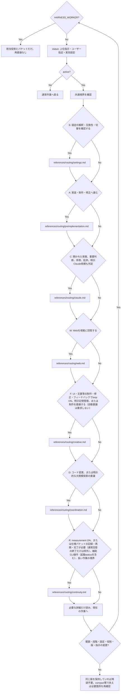

# Yes/No読込チャート

人向けの説明図。エージェントはSKILL.mdの判定表を使い、この図を常時読む必要はない。

生成元は[入口の独立判定表](../../SKILL.md#独立yesno判定表が正本)。各行を順に独立判定し、Yesで読んだあとも次行へ進む。複数Yesを許す。

| ID | Yes条件 | 本文（概要→必要な詳細） |
|---|---|---|
| S | 設定の解釈・互換性・切替を確認する | [設定](settings.md)：切替 |
| A | 実装・制作・修正へ進む | [提示・承認](preimplementation.md)：承認 |
| C | 開かれた発案、重要判断、停滞、批評。明示Claude依頼も判定 | [Claude](claude.md)：条件・権限 |
| W | Webを根拠に回答する | [出典](web.md)：根拠 |
| F | UI・文書等の制作・修正・フィードバックでloop ON、明示記憶管理、または制作を委譲する（自動委譲は要求しない） | [制作](creative.md)：記憶・保存 |
| D | コード変更、または明示的な大規模探索の委譲 | [調整](coordination.md)：委譲・レビュー |
| R | measurement ON、または仕様パケットの記録・再開・完了が必要（通常回答の終了だけは除外）、補助CLI操作（起動statusを含む）、長い作業の境界 | [継続](continuity.md)：保存・計測・CLI |
